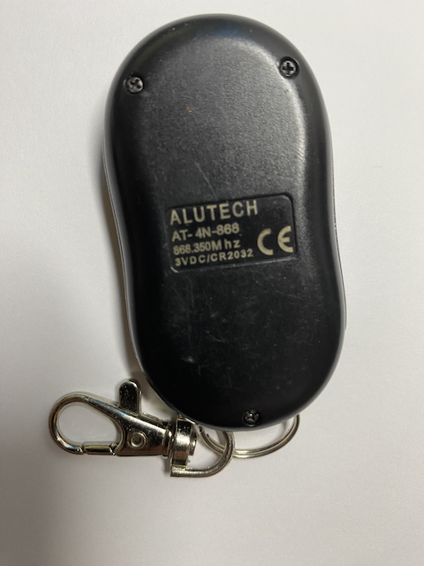
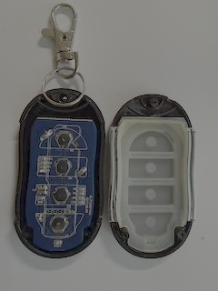
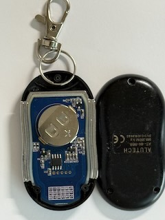
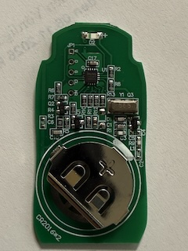

# ALUTECH AT-4N-868

Reverse engineering a garage door remote key fob.



## Findings

* **Protocol decoded.** Proprietary "Alutech AT-4N" scheme. Older units have
  no IC markings; a newer unit from Aliexpress (also works with this garage
  door) has U1 marked as the PUYA PY32F002A — the same Arm Cortex-M0+ chip
  debugged over SWD in this repo. Matches
  [Flipper's `alutech_at_4n.c`](https://github.com/flipperdevices/flipperzero-firmware/blob/dev/lib/subghz/protocols/alutech_at_4n.c):
  72-bit frame, CRC-8 poly `0x31`, XTEA-style Feistel cipher.
* **New keyfobs protect the rainbow table.** Read-out protection (RDP) is
  enabled on production units — SWD can't read flash, so the six constants
  can't be dumped. See [docs/firmware-extraction.md](docs/firmware-extraction.md).
* **Older units use a different, non-ARM chip** (2017-dated board, unmarked
  8-pin SOIC) — SWD doesn't apply to them at all, confirmed across every
  reasonable pin combination. Firmware access on those is a separate, closed
  dead end, not the same RDP block as the newer units.
* **Same six constants across the whole AT-4N line** — not per-device. One
  shared secret for the whole product line.
* **Flipper Zero ships the table, AES-encrypted.** Decryptable only with
  the AES key set during Flipper's own production (secure enclave) — not
  derivable from the public keystore file alone.
* **Flipper can decode/read a frame, not clone it** — no rainbow table, no
  replay.

## Steps
- [x] Decode the protocol
- [ ] Decode sampling rates with [I/Q Spectrogram & Pulsedata](https://triq.org/pdv3/)
- [x] Create a C rtl_433 decoder — done in the [fork](https://github.com/andy778/rtl_433/blob/master/src/devices/alutech_at_4n.c)
- [ ] Add samples to [rtl_433 tests](https://github.com/merbanan/rtl_433_tests)
- [ ] Submit the decoder upstream to [rtl_433 devices](https://github.com/merbanan/rtl_433/tree/master/src/devices)
- [x] Attempt firmware extraction over SWD — RDP confirmed enabled, blocked
- [x] Search SRAM for the rainbow table — negative result
- [ ] Behavioral replay / rolling-code resync analysis with Flipper Zero

## Datasheets

| No  | Description    | IC                                                                                                                            |
| --- | ---            | ---                                                                                                                           |
| U1  | Arm Cortex-M0+ (custom Alutech firmware) | [PUYA F002AW15 SH6HN1B](https://www.puyasemi.com/download_path/%E6%95%B0%E6%8D%AE%E6%89%8B%E5%86%8C/MCU%20%E5%BE%AE%E5%A4%84%E7%90%86%E5%99%A8/PY32F002A_Datasheet_V0.2.pdf)|

## Power supply

Board and manual specify one CR2032 (3V). Unit as delivered (Aliexpress)
shipped with **two CR2016 cells in series instead — 6V**, confirmed with a
multimeter. Spec mismatch, not a documented design.

The holder is a 2-contact spring clip with no middle tap, same total stack
height (3.2mm) either way — nothing stops the wrong battery combination.

**Open question:** if VDD gets the raw 6V with no regulator (plausible,
part is only spec'd 3V), that exceeds the PY32F002A's ~1.7–5.5V range —
possible reliability risk from a seller substitution, not intentional RF
range boost. Check VDD at JP1 `V` (see
[docs/firmware-extraction.md](docs/firmware-extraction.md)) to confirm.

## Reverse engineering

Universal Radio Hacker (URH) captured one keypress
(`urh_alutech.complex16s`). Raw IQ/RF captures aren't tracked in git — see
[Key Files](CLAUDE.md#key-files).

* 868.35 MHz ASK (OOK in URH).
* Rolling code — simple clone isn't enough.
* Preamble of 6 `a` in hex, message repeated 3x per keypress.
* Pause threshold of 10 captures preamble + message in one message.
* ~~Converting from URH to an RTL flex decoder using this as~~ [inspiration](https://github.com/klohner/klohner.github.io/blob/master/SDR/Decoding/Example_2019-01-24/README.md).

From the datasheet and captures:

* ~9350 µs window, 12 one-bits (~389 µs each).
* ~4150 µs break follows.
* `1` = ~370 µs short pulse. `0` = ~760 µs long pulse.
* Symbol period ~1123 µs.
* New Cortex-M0+ units repeat the message 6x, not 3x.

## Protocol match (Flipper Zero)

Matches Flipper's [`alutech_at_4n`](https://github.com/flipperdevices/flipperzero-firmware/blob/dev/lib/subghz/protocols/alutech_at_4n.c):

| Parameter | Capture | Flipper `alutech_at_4n` |
| --- | --- | --- |
| Bits | 72 | `min_count_bit_for_found = 72` |
| Modulation | OOK/ASK | OOK |
| Short / long | ~320–370 / ~740–760 µs | `te_short = 400` / `te_long = 800` (±140) |

Decoded frame (after decryption), per Flipper source:

* `serial` — 32-bit (bits 24–55)
* `cnt` (rolling counter) — 16-bit (bits 8–23)
* `btn` — 8-bit (bits 0–7): `0xFF`=1, `0x11`=2, `0x22`=3, `0x33`=4, `0x44`=5
* `crc` — 8-bit (bits 56–63), CRC-8 poly `0x31`

> Offsets above are for the **decrypted** frame. Raw on-air bits go through
> `magic_data` obfuscation + rainbow table — a flex decoder only sees
> encrypted form.

## rtl_433 decoder

Maintained in the rtl_433 fork —
[`src/devices/alutech_at_4n.c`](https://github.com/andy778/rtl_433/blob/master/src/devices/alutech_at_4n.c)
([commit `5f0a1d6`](https://github.com/andy778/rtl_433/commit/5f0a1d6cedf5a73256d8e7e582e52790eb35f7bb)),
headed upstream. Not vendored here, to avoid drift. Registers as
protocol **321**.

### Frame format

12-bit preamble (`0xfff`), ~4150 µs gap, 72-bit payload repeated. 9 bytes:

| Bits   | Field                       |
| ---    | ---                         |
| 0..63  | encrypted payload (8 bytes) |
| 64..71 | CRC-8                       |

* Each byte sent **LSB first** — bit-reversed (`reverse8`) before processing.
* **CRC-8, poly `0x31`, init `0xff`, reflected I/O** over the 8 payload
  bytes vs. the reversed CRC byte.

No secret needed for CRC validation + encrypted `code` output. Code changes
per press — good for presence detection, not for cloning.

```
rtl_433 -f 868.35M -s 1024k -R 321
```

```
model : Alutech-AT4N   Encrypted : 7EA354AE42FC6594   Integrity : CRC
```

### Optional decryption (serial / button / counter)

Payload encrypted with an **XTEA-style Feistel cipher**, keyed by **six
32-bit per-manufacturer constants** (rainbow table, shared across the AT-4N
line). Not public — shipped AES-encrypted in a Flipper Zero keystore,
decrypted by its secure-enclave key. Not brute-forceable (~128-bit
keyspace). No key embedded in rtl_433 — supply at runtime:

```
rtl_433 -f 868.35M -s 1024k -R 321:<m0>,<m1>,<m2>,<m3>,<m4>,<m5>
```

* Six 32-bit hex values, keystore order, any non-hex separator.
* Decrypted block has its own check byte — wrong/partial key falls back to
  encrypted-only output, no garbage.
* Correct key adds **`id`** (serial), **`button`** (1–5), **`counter`**.

Decrypted field layout:

| Byte    | Field                                  |
| ---     | ---                                    |
| dec[0]  | button (`0xff`→1, `0x11`→2, `0x22`→3, `0x33`→4, `0x44`→5) |
| dec[1..2] | rolling counter (little-endian)      |
| dec[3..6] | serial (little-endian)               |
| dec[7]  | internal check byte                    |

Cipher and field layout ported from Flipper Zero
(`lib/subghz/protocols/alutech_at_4n.c`).

## Firmware extraction attempt

Tried dumping firmware over SWD, see
[docs/firmware-extraction.md](docs/firmware-extraction.md). Debug port
works — core halts, SRAM/registers read fine (CPUID `0x410cc601` = genuine
Cortex-M0+) — but flash reads are rejected outright. **RDP is enabled** on
production units. Not a probe/wiring issue. Non-invasive extraction is a
dead end; protocol analysis here is RF-based and doesn't need it.

## Images



