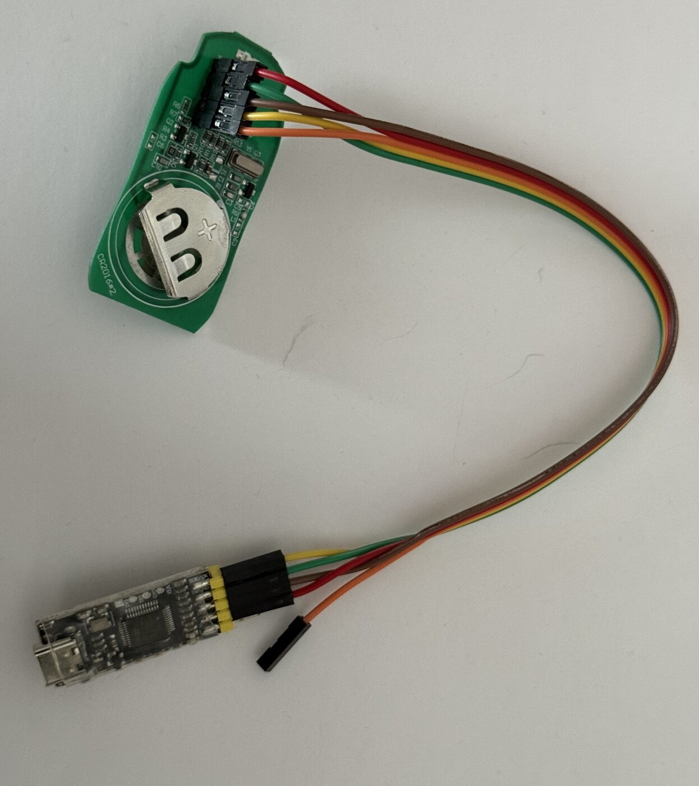

# Extracting the firmware from an AT-4N-868 keyfob

> **Scope:** this documents dumping the firmware from **your own** remote's MCU so
> you can study the rolling-code implementation. It does **not** cover, and this
> project will not help with, obtaining the shared per-manufacturer "rainbow
> table" secret that would let you clone arbitrary AT-4N remotes.

The transmitter is built around a **PUYA PY32F002A** — an Arm Cortex-M0+ MCU
(marked `Puya` on U1). The firmware lives in on-chip flash at `0x08000000`
(20 KB on this part). You read it out over the **SWD** debug port.

Register addresses and behavior cited below ("RM §x.y") are from the official
[PY32F002A Reference Manual V1.0](https://download.py32.org/ReferenceManual/en/PY32F002A%20Reference%20manual%20v1.0_EN.pdf).

## 1. Hardware you need

| Item | Notes |
| --- | --- |
| SWD debug probe | **USBDM** (in ARM SWD mode), ST-Link V2, or a CMSIS-DAP probe all work. |
| Jumper wires / test hooks | The JP1 pads are small; hook clips or a pogo jig help. |
| Multimeter | To sanity-check pin identity before powering anything. |
| Host software | **pyOCD** + Puya's official `Puya.PY32F0xx_DFP` CMSIS-Pack (recommended — see §4). OpenOCD works too, but has no stock PY32 target file; see the OpenOCD note in §4/§5. |

The PY32F002A is a 3.3 V part. Power it from the coin cell already in the fob, or
from the probe's 3V3 — **never both at once**.

## 2. The JP1 debug header

The board carries a labelled 5-pad header, **JP1**. Reading the silk top-to-bottom:

| JP1 label | Signal | PY32 pin |
| --- | --- | --- |
| `V`  | VCC / 3V3 | VDD |
| `D`  | SWDIO | PA13 |
| `G`  | GND | VSS |
| `CL` | SWCLK | PA14 |
| `NR` | NRST | NRST |

### Confirm with a multimeter before wiring

Do this with the battery **in**, probe **disconnected**:

- `G` → continuity to the battery negative terminal / ground plane.
- `V` → reads the battery voltage (~3 V) against `G`.

If `G` and `V` are swapped from what you expect, stop and re-check the silk
orientation — powering the part backwards will kill it.

## 3. Wiring to the probe

Minimum connection is four wires:

```
JP1            probe
 V  (VDD)  --- 3V3   (only if NOT using the coin cell)
 D  (SWDIO)--- SWDIO
 CL (SWCLK)--- SWCLK
 G  (GND)  --- GND
 NR (NRST) --- RESET (optional but recommended; lets the probe
                      connect-under-reset if the firmware reconfigures
                      the SWD pins as GPIO)
```

Keep the leads short — SWD is happier at the lower adapter clock speeds if the
wiring is long.



Verified working setup: fob's JP1 header wired to a generic CMSIS-DAP probe
clone (USB ID `c251:f001`) via four jumper wires (`V`/`D`/`CL`/`G`); the
5th wire (`NR`/NRST, black connector dangling loose) was left unconnected
for this session and wasn't needed. Visible on the fob's PCB: the `CR2016*2`
silkscreen confirming the power-supply finding that this unit takes two
stacked CR2016 cells rather than the single CR2032 the manual specifies.

## 4. Read the protection state first

Before trying to dump anything, check the **option bytes / RDP (read-out
protection)** level. If the vendor set RDP, the debug port will refuse to read
flash, and on many parts an attempt plus a level change will **mass-erase** the
chip — so look, don't poke.

**PY32 has no stock target support in either OpenOCD or pyOCD** — plan for
that up front. The pyOCD route below is **verified end-to-end on a production
unit**, using a generic "CMSIS-DAP simulator" probe clone (USB ID `c251:f001`,
Keil CMSIS-DAP HID firmware, supports Cortex-M0/M3/M4/M7):

- **pyOCD (recommended, verified working):** Puya's `Puya.PY32F0xx_DFP`
  CMSIS-Pack is already in pyOCD's default online pack index as of this
  writing (v1.2.8) — **no manual `.pack` download needed**, contrary to
  earlier guidance here. Confirm the probe, find the pack, install it, then
  connect:

  ```bash
  sudo pyocd list                                # confirm the probe is detected
  sudo pyocd pack find PY32                      # confirms PY32F002Ax5 is indexed
  sudo pyocd pack install PY32F002Ax5            # downloads + installs the pack
  sudo pyocd list --targets | grep -i py32f002   # confirms py32f002ax5 is now available
  sudo pyocd cmd -t py32f002ax5 -c "reset halt" -c "read32 0x08000000 16"
  ```

  No `-f <freq>` clock override or `--pack=` path was needed once the pack was
  installed — default clock speed worked fine on this probe/wiring.

  `sudo` was required throughout on this specific probe — the stock
  `/usr/lib/udev/rules.d/50-cmsis-dap.rules` allow-list covers several known
  CMSIS-DAP vendor/product IDs but not this clone's `c251:f001`. For
  passwordless access, add your own rule, e.g. in
  `/etc/udev/rules.d/99-cmsis-dap-local.rules`:
  ```
  SUBSYSTEM=="usb", ATTR{idVendor}=="c251", ATTR{idProduct}=="f001", MODE:="0660", TAG+="uaccess"
  ```
  then `sudo udevadm control --reload && sudo udevadm trigger`.

  If that connects and returns real-looking code bytes (not all `00`/`FF`, and
  no fault/error), RDP is **disabled** — proceed to §5. If the connect fails,
  or reads come back as a fault (`Error: memory transfer failed`) or
  all-zero/all-`FF`, RDP is likely **enabled** (see §6).

- **OpenOCD:** there is no `target/py32f0x.cfg` in stock OpenOCD — the naive
  `-f target/py32f0x.cfg` invocation you may see elsewhere will fail with
  "Can't find target/py32f0x.cfg". Either build a patched OpenOCD such as
  [OlegGalizin/openocd-for-py32f0xx](https://github.com/OlegGalizin/openocd-for-py32f0xx),
  or write a minimal custom target script (community projects like
  [py32f0xx-hal](https://github.com/py32-rust/py32f0xx-hal/blob/main/openocd.cfg)
  do `transport select swd; set CHIPNAME py32f030` over a generic Cortex-M0
  boilerplate) — unverified by this project, treat as a starting point to test
  yourself, not a known-good recipe.

### Troubleshooting: VMware Workstation's USB arbitrator

If VMware Workstation/Player is installed, its `vmware-usbarbitrator` service
claims USB devices on plug-in for possible VM passthrough — including debug
probes — and can repeatedly rebind or fully disconnect them mid-session. This
shows up as a `hid-generic` bind/unbind loop in `journalctl`, ending in a
`USB disconnect`, and can present as a flaky or failing SWD connection that
has nothing to do with wiring. If your probe drops out or `pyocd list`
intermittently sees nothing, stop the arbitrator for the session:

```bash
sudo systemctl stop vmware-usbarbitrator.service
# ... do your debugging, replug the probe ...
sudo systemctl start vmware-usbarbitrator.service   # when done
```

This blocks VM USB passthrough while stopped — restart it afterward if you
need that for other VMs.

## 5. Dump the flash

Once you can halt the core (§4), read the 20 KB flash region with pyOCD:

```bash
sudo pyocd cmd -t py32f002ax5 -c "reset halt" -c "savemem 0x08000000 0x5000 at4n_flash.bin"
```

`0x5000` = 20480 bytes. Adjust if your part reports a different flash size.

With a working OpenOCD target file (see the caveat in §4):

```bash
openocd -f interface/cmsis-dap.cfg -f target/py32f0x.cfg \
    -c "init; halt; dump_image at4n_flash.bin 0x08000000 0x5000; shutdown"
```

Verify you got real code, not a blank/`0xFF` image:

```bash
xxd at4n_flash.bin | head          # expect a vector table at the top
```

The first word is the initial stack pointer (`0x2000xxxx` for RAM), the second is
the reset-handler address (`0x0800xxxx`) — a good quick sanity check.

## 6. If RDP is enabled

**Confirmed on a production unit (2026-07-17):** with a working SWD link
(pyOCD + Puya's `Puya.PY32F0xx_DFP`, `-t py32f002ax5`), the core halts and
responds to debug commands normally, and general memory reads succeed —

```
reset halt                                    -> "Successfully halted device on reset"
read32 0x20000000 4  (SRAM)                   -> 200005a0   (real data)
read32 0xE000ED00 4  (Cortex-M CPUID)         -> 410cc601   (ARM, ARMv6-M, part 0xC60 = Cortex-M0+)
read32 0x08000000 16 (flash)                  -> "Error: memory transfer failed"
```

The flash read specifically failing — not reading back as blank `0xFFFFFFFF`,
but the transfer itself being rejected — while SRAM and core-register reads
work fine, matches the PY32F002A reference manual §4.6.2 exactly: *"In debug
mode... the main Flash memory cannot be accessed. In these modes, a bus error
is generated for a read... access to the main Flash, and a hard fault
interrupt is generated."* (RM, Table 4-8, Level 1 protection, debug-mode row).

That alone is strong circumstantial evidence, but the option-byte word settles
it directly rather than by inference. The RDP value itself lives at
`0x1FFF0E80`, bits `[7:0]`, with its one's complement mirrored in bits
`[23:16]` (RM §4.4.1, §4.8.6):

```
read32 0x1FFF0E80 4   -> 41FFBE00
```

Splitting that word: `RDP[7:0] = 0x00`, `~RDP[7:0] = 0xFF` — an exact
complement pair, so the read is internally consistent (no `OPTVERR`
corruption). Per RM Table 4-7, only the specific pair `RDP=0xAA / ~RDP=0x55`
means Level 0 (protection inactive); any other value — `0x00`/`0xFF` included
— means **Level 1: read protection is active**. This is the actual
protection-level bit read directly from silicon, not inferred from the failed
transfer above.

For context, `read32 0x1FFF0000 4` (system memory / boot ROM base) returned
`0x20000200` — a plausible Cortex-M initial stack pointer into the 3KB SRAM —
confirming the debug link and general memory access are fully healthy; it is
specifically main-flash access that RDP blocks.

If you hit the same pattern, the SWD route is closed without invasive attacks
(voltage glitching, decapping) which are out of scope here. Your options for
studying the protocol are:

- Capture and analyse the **RF** side, which is what the rest of this project
  does — you do not need the firmware to validate the frame, CRC, or observe the
  rolling-code behaviour.
- Recover the encryption constants only from a source you are entitled to.

## 7. What to do with the dump

Once you have `at4n_flash.bin`, disassemble it (Ghidra, `arm-none-eabi-objdump
-D -b binary -m armv6-m`, or Cutter) and look for:

- the CRC-8 routine (poly `0x31`) applied per-frame,
- the XTEA-style Feistel round that mixes the payload with six 32-bit constants,
- those six constants themselves, which the firmware must hold to encrypt.

That closes the loop with the
[rtl_433 decoder](https://github.com/andy778/rtl_433/blob/master/src/devices/alutech_at_4n.c)
(maintained in the `andy778/rtl_433` fork), whose optional decryption path
takes exactly those six values as `-R 321:<m0>,<m1>,<m2>,<m3>,<m4>,<m5>`.

## 8. SRAM search (negative result)

Since RDP blocks flash but the debug port can still read **SRAM** (§6), it's
worth asking whether the six magic constants ever get staged in RAM at
runtime and could be recovered from a live snapshot instead.

**Dumping SRAM at rest:**

```bash
sudo pyocd cmd -t py32f002ax5 -c "reset halt" -c "savemem 0x20000000 0xC00 sram_dump.bin"
```

A 3 KB dump (`0xC00`) on a production unit broke down into three zones:

| Range | Content |
|---|---|
| `0x000–0x1BF` | Vector table copy + init data — real flash addresses, peripheral base addresses, small integers (low entropy, clearly structured) |
| `0x1C0–0x4FF` | All zero — untouched SRAM |
| `0x5A0–0xBFF` | Uniformly high entropy (~5.7–5.9 bits/byte) — everything *above* the reported initial stack pointer (`0x200005a0`), i.e. never zeroed, plausibly stale data from an earlier function call |

That high-entropy region is the interesting candidate, but entropy alone
can't distinguish leftover crypto material from ordinary SRAM power-on noise
— they look statistically identical. Eyeballing isn't a real test.

**Verification method:** every 4-byte-aligned 24-byte window in the dump
(763 positions, then widened to unaligned offsets and both byte orders —
6,098 total) was tried as a candidate six-constant set against the actual
`alutech_decrypt` Feistel algorithm, run against **two independently
verified real captured encrypted payloads** from this project
(`ACFC7B07CA43D233`, `64E4071F84EB463B` — see [README](../README.md#rtl_433-decoder)).
A candidate only counts if the internal check byte validates on **both**
frames independently (a single frame alone has a 1-in-256 chance of a false
positive from pure luck; requiring both drops that to ~1-in-65536). A cheap
modular-arithmetic pre-filter (the cipher's round count must resolve to a
small integer, since `magic[3]` is a delta-style constant with a bounded
round trip) kept the search both fast and precise.

**Result: 0 hits out of 6,098 candidate windows**, aligned and unaligned,
both endiannesses.

This specific static snapshot does not contain the six constants in a
directly-recoverable form. Two explanations are equally plausible and this
test can't distinguish them:

1. The firmware reads the constants straight out of flash `.rodata` on each
   round without ever staging a full copy in RAM — a resting snapshot would
   never show it, live or not.
2. It was staged in RAM at some point (there's evidence of recent interrupt
   activity in the stack region) but got overwritten by later calls before
   the dump was taken.

Settling which would require catching it **live** — single-stepping or
breakpointing the crypto routine during an actual keypress — which runs into
the same wall RDP creates on purpose: you'd need to know where that routine
lives in flash to set the breakpoint, and flash is exactly what's blocked.
Treat this avenue as exhausted without a substantially more invasive effort
(which is out of scope per this repo's [security boundary](../SECURITY.md)).
