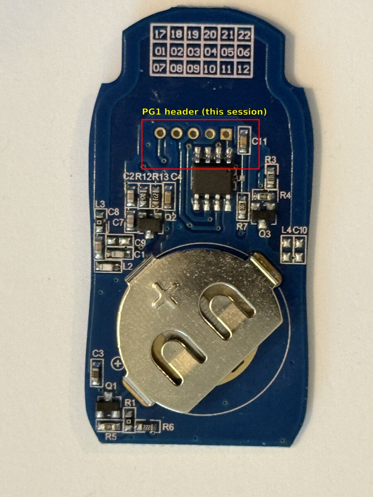
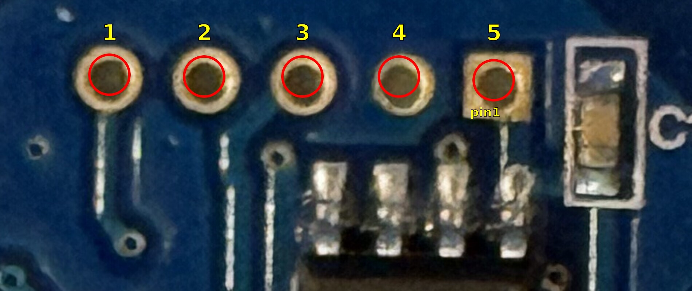

# Extracting the firmware from an AT-4N-868 keyfob

> **Scope:** dumping firmware from **your own** remote only. Not covered:
> obtaining the shared manufacturer "rainbow table" secret.

MCU: **PUYA PY32F002A**, Arm Cortex-M0+ (marked `Puya` on U1). Flash at
`0x08000000`, 20 KB. Read out over **SWD**.

Register addresses below ("RM §x.y") are from the
[PY32F002A Reference Manual V1.0](https://download.py32.org/ReferenceManual/en/PY32F002A%20Reference%20manual%20v1.0_EN.pdf).

Sections 1–8 cover this (newer) unit. **Older units use a different, non-ARM
chip — see §9, SWD does not apply to them.**

## 1. Hardware

| Item | Notes |
| --- | --- |
| SWD probe | USBDM (ARM SWD mode), ST-Link V2, or CMSIS-DAP — all work |
| Jumper wires / hooks | JP1 pads are small |
| Multimeter | Check pin identity before powering up |
| Software | pyOCD + Puya's `Puya.PY32F0xx_DFP` pack (§4) |

3.3 V part. Power from the coin cell or the probe's 3V3 — **never both**.

## 2. JP1 header

5-pad header, top to bottom on the silk:

| JP1 | Signal | PY32 pin |
| --- | --- | --- |
| `V`  | VCC/3V3 | VDD |
| `D`  | SWDIO | PA13 |
| `G`  | GND | VSS |
| `CL` | SWCLK | PA14 |
| `NR` | NRST | NRST |

Before wiring, battery in, probe disconnected:
- `G` → continuity to battery negative.
- `V` → ~3 V against `G`.

Swapped? Stop — wrong polarity kills the part.

## 3. Wiring

```
JP1            probe
 V  (VDD)  --- 3V3   (skip if powering from the coin cell)
 D  (SWDIO)--- SWDIO
 CL (SWCLK)--- SWCLK
 G  (GND)  --- GND
 NR (NRST) --- RESET (optional, helps if SWD pins get reused as GPIO)
```

Keep leads short.


Verified setup: CMSIS-DAP clone (`c251:f001`), 4 wires connected, NRST
unused. PCB silkscreen shows `CR2016*2` — matches the
[power-supply finding](../README.md).

## 4. Check RDP first

RDP (read-out protection) blocks flash reads. On some parts, poking it wrong
triggers a mass erase — check before writing anything.

PY32 has no stock target file in OpenOCD or pyOCD. Verified working path:
pyOCD + Puya's DFP.

```bash
sudo pyocd list                                # probe detected?
sudo pyocd pack find PY32                      # confirms PY32F002Ax5 is indexed
sudo pyocd pack install PY32F002Ax5            # installs it
sudo pyocd list --targets | grep -i py32f002   # confirms py32f002ax5 available
sudo pyocd cmd -t py32f002ax5 -c "reset halt" -c "read32 0x08000000 16"
```

No manual `.pack` download needed, no clock override needed — default speed
works.

`sudo` is needed because `c251:f001` isn't in the stock udev allow-list
(`/usr/lib/udev/rules.d/50-cmsis-dap.rules`). For passwordless access, add:

```
# /etc/udev/rules.d/99-cmsis-dap-local.rules
SUBSYSTEM=="usb", ATTR{idVendor}=="c251", ATTR{idProduct}=="f001", MODE:="0660", TAG+="uaccess"
```
then `sudo udevadm control --reload && sudo udevadm trigger`.

**Result:** real code bytes, no fault → RDP disabled, go to §5.
Fault (`Error: memory transfer failed`) or all-zero/`FF` → RDP likely
enabled, see §6.

OpenOCD alternative: no `target/py32f0x.cfg` ships with stock OpenOCD. Either
build [OlegGalizin/openocd-for-py32f0xx](https://github.com/OlegGalizin/openocd-for-py32f0xx)
or write a custom target script (see
[py32f0xx-hal](https://github.com/py32-rust/py32f0xx-hal/blob/main/openocd.cfg)
for a starting point). Unverified — test yourself.

**VMware Workstation:** its `vmware-usbarbitrator` service claims USB probes
on plug-in and can rebind/disconnect them mid-session, looking exactly like
a flaky SWD link. If the probe drops out:

```bash
sudo systemctl stop vmware-usbarbitrator.service
# ... debug, replug probe ...
sudo systemctl start vmware-usbarbitrator.service
```

## 5. Dump flash

```bash
sudo pyocd cmd -t py32f002ax5 -c "reset halt" -c "savemem 0x08000000 0x5000 at4n_flash.bin"
```

`0x5000` = 20480 bytes, adjust for your part's flash size.

OpenOCD (needs a working target file, see §4):

```bash
openocd -f interface/cmsis-dap.cfg -f target/py32f0x.cfg \
    -c "init; halt; dump_image at4n_flash.bin 0x08000000 0x5000; shutdown"
```

Sanity check:

```bash
xxd at4n_flash.bin | head
```

First word = initial stack pointer (`0x2000xxxx`), second = reset handler
(`0x0800xxxx`).

## 6. RDP enabled — confirmed

```
reset halt                              -> halted OK
read32 0x20000000 4  (SRAM)             -> 200005a0   real data
read32 0xE000ED00 4  (CPUID)            -> 410cc601   Cortex-M0+
read32 0x08000000 16 (flash)            -> Error: memory transfer failed
```

Flash read rejected, SRAM/CPUID fine — matches RM §4.6.2: debug-mode flash
access is blocked with a bus error under RDP Level 1 (Table 4-8).

Direct confirmation from the option byte at `0x1FFF0E80` (RM §4.4.1, §4.8.6):

```
read32 0x1FFF0E80 4   -> 41FFBE00
```

`RDP[7:0] = 0x00`, `~RDP[7:0] = 0xFF` — valid complement pair. Per RM
Table 4-7, only `RDP=0xAA / ~RDP=0x55` means Level 0. Anything else,
including this, means **Level 1: protection active**.

`read32 0x1FFF0000 4` (boot ROM) → `0x20000200`, a plausible SRAM stack
pointer — confirms the debug link is otherwise healthy; only flash is
blocked.

No non-invasive path forward (voltage glitching/decapping out of scope).
Options:
- RF-side analysis, which the rest of this project already does.
- Recover the constants only from a source you're entitled to.

## 7. Using the dump

Disassemble (`arm-none-eabi-objdump -D -b binary -m armv6-m`, Ghidra, Cutter)
and look for:

- the CRC-8 routine (poly `0x31`),
- the Feistel round using six 32-bit constants,
- the constants themselves.

Feeds the
[rtl_433 decoder](https://github.com/andy778/rtl_433/blob/master/src/devices/alutech_at_4n.c)'s
`-R 321:<m0>,<m1>,<m2>,<m3>,<m4>,<m5>` option.

## 8. SRAM search — negative result

RDP blocks flash but not SRAM. Tried whether the six constants show up in a
resting SRAM snapshot.

```bash
sudo pyocd cmd -t py32f002ax5 -c "reset halt" -c "savemem 0x20000000 0xC00 sram_dump.bin"
```

3 KB dump, three zones:

| Range | Content |
|---|---|
| `0x000–0x1BF` | Vector table copy + init data, low entropy |
| `0x1C0–0x4FF` | All zero — untouched |
| `0x5A0–0xBFF` | High entropy (~5.7–5.9 bits/byte) — above the stack pointer, never zeroed |

High entropy alone doesn't tell secret from noise, so it was tested, not
eyeballed: every 4-byte-aligned 24-byte window (763, then unaligned +
both byte orders, 6,098 total) run through the real `alutech_decrypt`
algorithm against two independently verified captured payloads
(`ACFC7B07CA43D233`, `64E4071F84EB463B`). A hit needs the check byte to pass
on **both** frames (~1-in-65536 chance of a fluke, vs. 1-in-256 for one).

**Result: 0 hits out of 6,098.**

Two equally plausible reasons, can't distinguish without more work:
1. Constants read straight from flash `.rodata` each round, never staged in RAM.
2. Staged once, overwritten before the dump.

Settling it needs a live capture during an actual keypress — same wall as
before: no flash read means no way to find the routine to breakpoint. Out of
scope per [SECURITY.md](../SECURITY.md).

## 9. Older units — different chip, SWD doesn't apply (negative result)

Sections 1–8 are all the **newer** PY32F002A unit. An **older** board
(`back.jpg`/`front.jpg` in this repo — silkscreen `ELTYKQ71AA`, dated
2017.06.03) uses a different chip entirely. SWD access does not apply to it.

**Board identification.** 5-pad header labelled `PG1` on the front silkscreen
(between the K1/K2 buttons), square pad = pin 1 — same 5-pin convention as
JP1 on the newer board, different physical board. Confirmed by multimeter:
pad 4 = GND (continuity to battery negative), pad 5 = VCC (~3.04V, single
CR2032 — this board predates the 2×CR2016 mismatch found on the newer unit).
Board is unpowered at rest — a button press mechanically closes the
battery-to-VCC connection (zero quiescent draw), so measurements/debug
attempts need a button held or VCC wired directly.




**Chip identification failed.** 8-pin SOIC, cleaned with IPA and inspected
at 5x magnification under multiple lighting angles — no recoverable part
marking. Genuinely blank, not just worn.

**Why it's not the PY32F002B** (same product line, SOP8 package, would have
been the next guess): 2017 predates Puya's PY32 MCU line, which reached
market around 2021. Confirmed independently — the physical GND pin position
on this board doesn't match the PY32F002B SOP8 datasheet pinout (GND is
pin 8 there). Different chip family, not just a different Puya part.

**SWD exhausted.** Same verified probe (CMSIS-DAP `c251:f001`) and pyOCD,
generic `cortex_m` target (no vendor pack — chip is unknown):

```bash
sudo pyocd cmd -t cortex_m -f 100000 -c "reset halt" -c "read32 0xE000ED00 4"
sudo pyocd cmd -t cortex_m -M under-reset -f 100000 -c "reset halt" -c "read32 0xE000ED00 4"
```

Tried every SWDIO/SWCLK pairing among the 3 unidentified header pads, both
with a normal connect and with `-M under-reset` (third pad wired to the
probe's NRST line each time). **Every combination: `SWD/JTAG communication
failure (No ACK)`.** Power confirmed correct throughout (LED lit).

JTAG not testable either — no exposed CLI flag, and standard JTAG needs 4
signal wires (TCK/TMS/TDI/TDO); only 3 unidentified pads are available.

**Conclusion:** CMSIS-DAP/pyOCD are ARM-only tools. Consistent, total "No
ACK" across every reasonable pin combination, on hardware with confirmed-good
power wiring, points to this chip not being ARM/SWD-capable at all rather
than a wiring problem. Closed without a positively identified chip and a
protocol-appropriate tool — out of scope for this repo without that.
